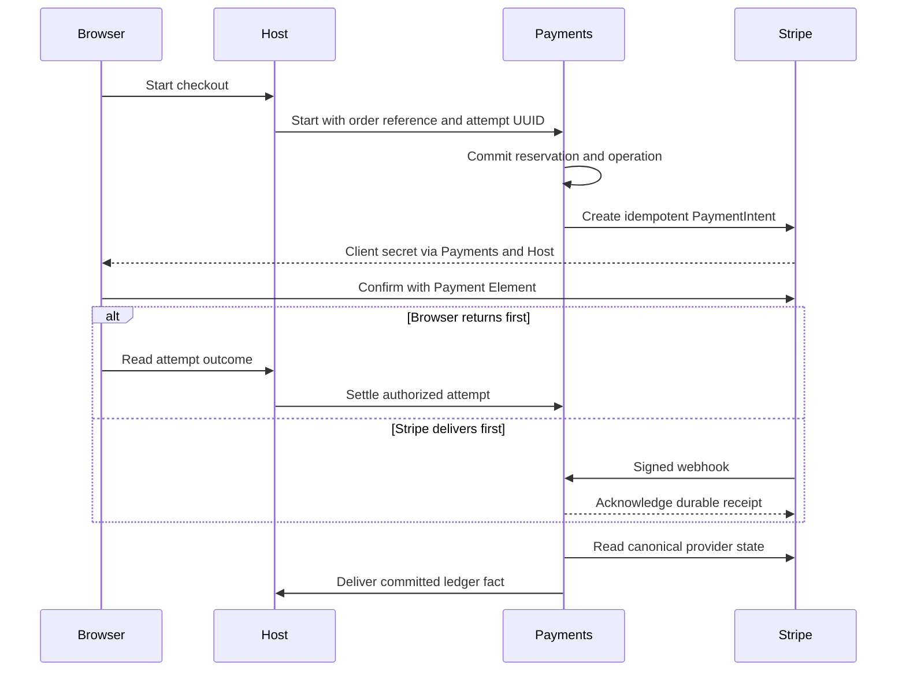
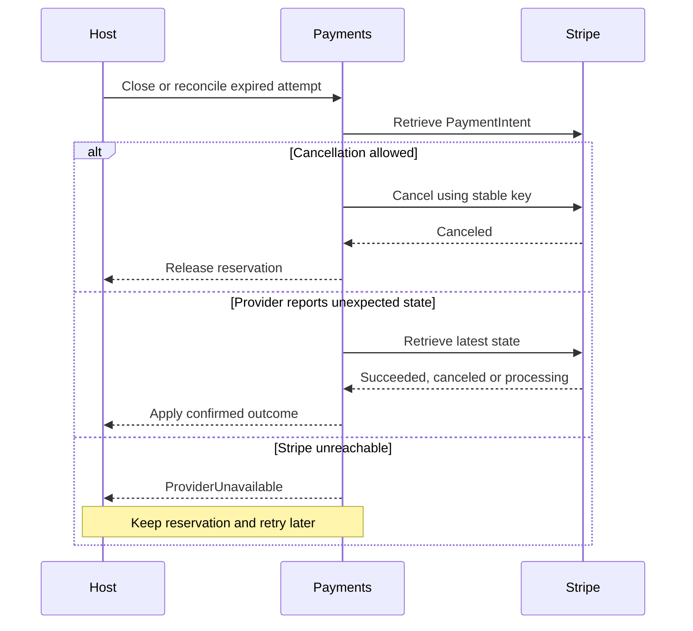
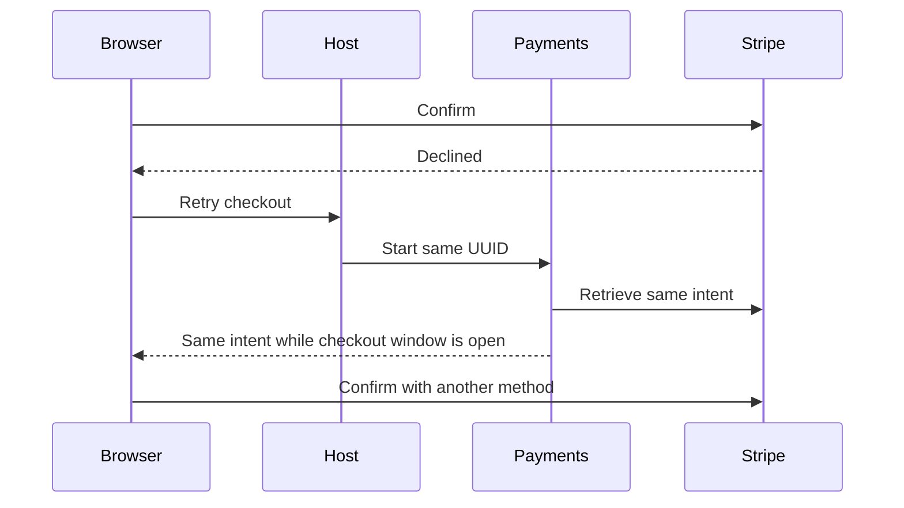

# Payment Element integration

The host owns pricing, checkout UI, order authorization and fulfillment. Bind
`PaymentOrderProvider` and `PaymentManagementAccess`; bind
`ExistingPaymentOwnership` if you import external payments. The order resolver
returns a server-calculated snapshot in integer minor units and ISO currency
codes. Enable the package only after migrations and host authorization are in
place.

Configure `stripe.secret`, `stripe.publishable_key`, `stripe.account_id` and
`stripe.livemode`. EUR is allowed by default and its minimum is 50. Set
`allowed_currencies` and `minimum_amounts` per currency. Embedded defaults are
`automatic_async`, `['card']` and a 30-minute window. Apple Pay and Google Pay
use the card method on eligible browsers and registered payment method domains.
Hosted Checkout retains its `automatic` default and configured `manual` support.
Both flows support `automatic`, `automatic_async` and `manual`. Manual capture
uses the existing card authorization API and supports final partial capture. The authorized order
timeline exposes the Stripe charge ID and available card brand, last four,
expiry month and year, and wallet for embedded payments.

## Start, confirm and settle

Generate a globally unique UUID for each host payment attempt and persist it
before calling the package. Use the same UUID on network retries for the same
immutable order revision. If the order changes, close the previous attempt before
starting a new one. Embedded and hosted checkout share the order reservation.

```php
use Nvl\Payments\Services\EmbeddedPayments;

$checkout = app(EmbeddedPayments::class)->start($orderReference, $attemptUuid, $actor);
```

Return the five result fields only to the authorized checkout shopper. Send a
`Cache-Control: no-store` response and keep the client secret out of URLs, logs
and analytics. Initialize Stripe.js with `publishableKey`, call
`stripe.elements({ clientSecret })`, mount the Payment Element and call
`stripe.confirmPayment({ elements, confirmParams: { return_url }, redirect: 'if_required' })`.
On return, authorize the attempt in the host and call
`EmbeddedPayments::settle($attemptUuid, $actor)`. Use the saved attempt UUID
for correlation. A browser confirmation or redirect is never fulfillment
authority. The host must authorize `start_embedded`, `settle_embedded`,
`close_embedded` and `recover_embedded` as distinct operations.



## Close, expiry and recovery

`close($attemptUuid, $actor)` reports true only after confirmed cancellation and
reservation release. A paid response settles the payment and returns false.
A processing response leaves the order reserved. Reconciliation tries to cancel
expired unpaid intents and uses the same remote cancellation key as close. A
shopper with an open browser may still confirm until Stripe cancels the intent.
Schedule `nvl:payments:reconcile` frequently enough for the checkout window.





A failed or timed-out create can be retried with the same UUID and original
snapshot inside the checkout window. When Stripe's idempotency window may have
expired, reuse the known Stripe intent ID through
`recover($attemptUuid, $intentId, $actor)`. The remote intent must prove the
original operation key. If no ID is known, inspect the Stripe account and
preserve the reservation while investigating.

| Stripe status or package status | Host action |
| --- | --- |
| `requires_payment_method` / `open` | Mount or retry the Payment Element on the same intent. |
| `failed` | Display the decline and allow another method on the same open intent. |
| `requires_confirmation`, `requires_action` | Let Stripe.js confirm or handle authentication. |
| `processing` | Show pending and wait for a webhook or another authorized settle. |
| `requires_capture` / `authorized` | Capture or cancel through the existing authorization service. |
| `succeeded` / `captured` | Fulfill from committed server-side payment evidence. |
| `partially_refunded`, `refunded` | Update the order from refund facts. |
| `canceled`, `expired` | Offer a new attempt after confirmed release. |
| `reserved`, `unknown` | Retain the attempt and recover the provider outcome. |
| `payment_exception` | Stop fulfillment and investigate the reason and Stripe evidence. |
| `ProviderUnavailable` | Retry transient network, limit and server failures using the same identity. |
| `ProviderRefused` | Inspect the Stripe code before changing inputs or configuration. |

An embedded intent paid after local close, for a different amount, or in a
different currency enters `payment_exception` with `paid_after_close`,
`amount_mismatch` or `currency_mismatch`. Handle any funds through a controlled
Stripe remediation process. The checkout remains in exception for investigation.

For signed-in shoppers, optionally enable `customers.enabled` and pass the
trusted host customer reference as the fourth argument to `start()`. Scope
that reference globally across tenants in this deployment. Guests omit it.
The package creates one Stripe customer mapping and reuses the stored ID without
changing existing Stripe customer details.

For a custom provider adapter, bind `PaymentGateway` to the adapter that
implements `PaymentIntentGateway`. The same binding supplies authoritative
reads for reconciliation and webhook settlement. Implement
`PaymentRefundLookup` to handle refund-object events through that adapter.

All Stripe calls must run after the payments connection leaves its outer
transaction. Commit the host snapshot first, then call the payment service.

Stripe references cover [PaymentIntent creation](https://docs.stripe.com/api/payment_intents/create),
[Payment Element confirmation](https://docs.stripe.com/js/payment_intents/confirm_payment),
[PaymentIntent status](https://docs.stripe.com/api/payment_intents/object),
[cancel](https://docs.stripe.com/api/payment_intents/cancel),
[capture](https://docs.stripe.com/api/payment_intents/capture),
[Checkout creation](https://docs.stripe.com/api/checkout/sessions/create),
[idempotency](https://docs.stripe.com/api/idempotent_requests) and
[currency minimums](https://docs.stripe.com/currencies#minimum-and-maximum-charge-amounts).
